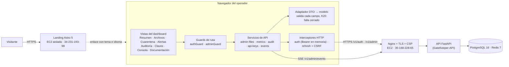
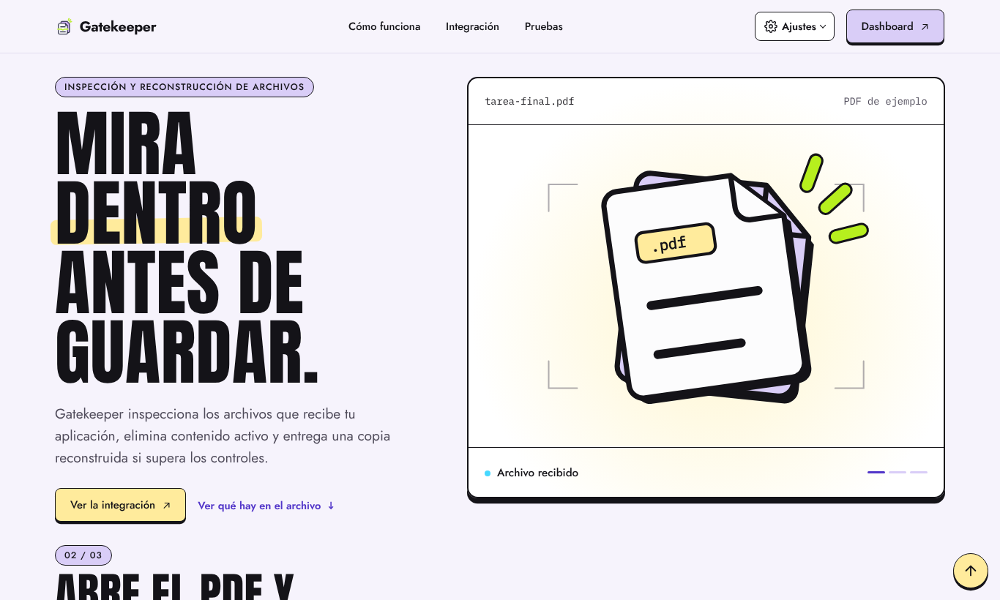
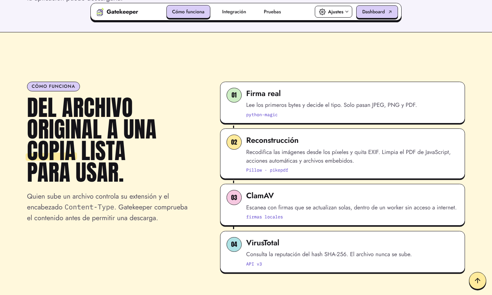
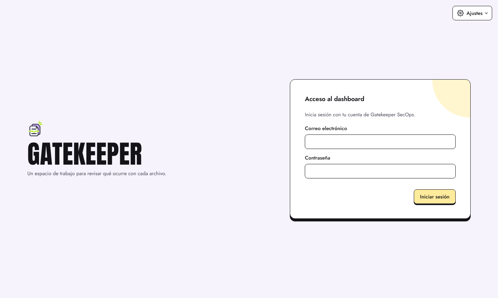
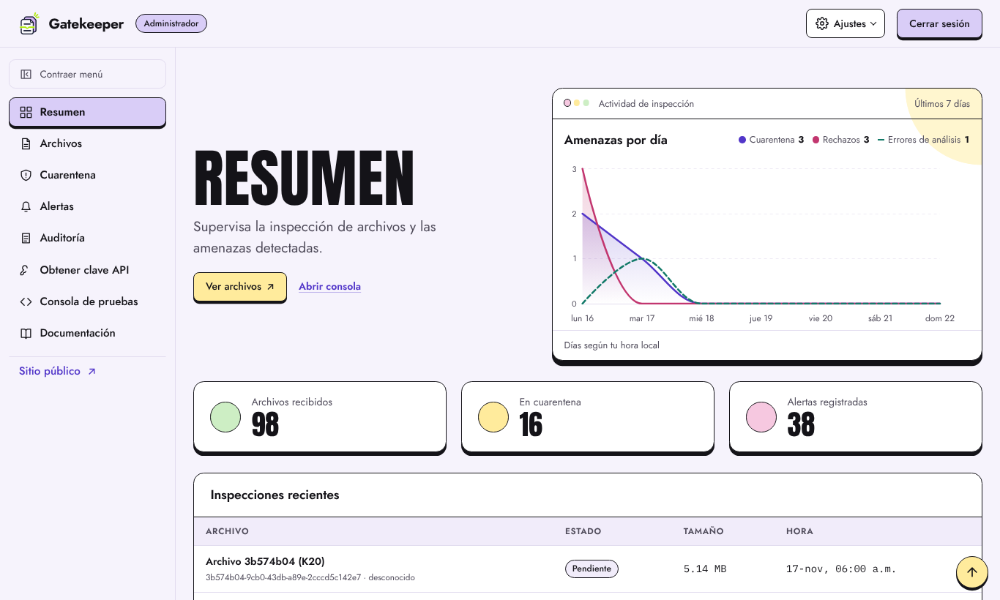
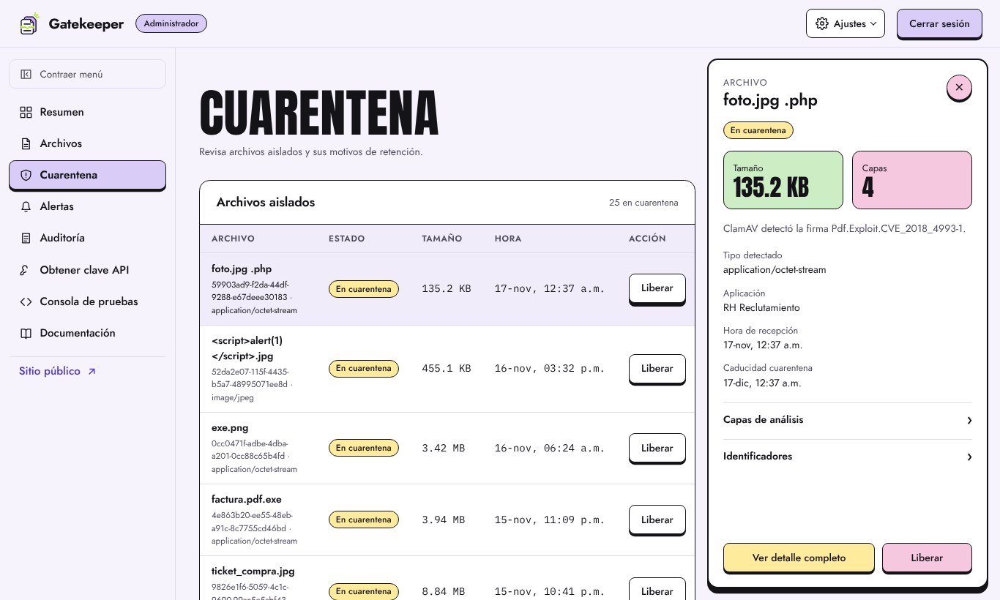
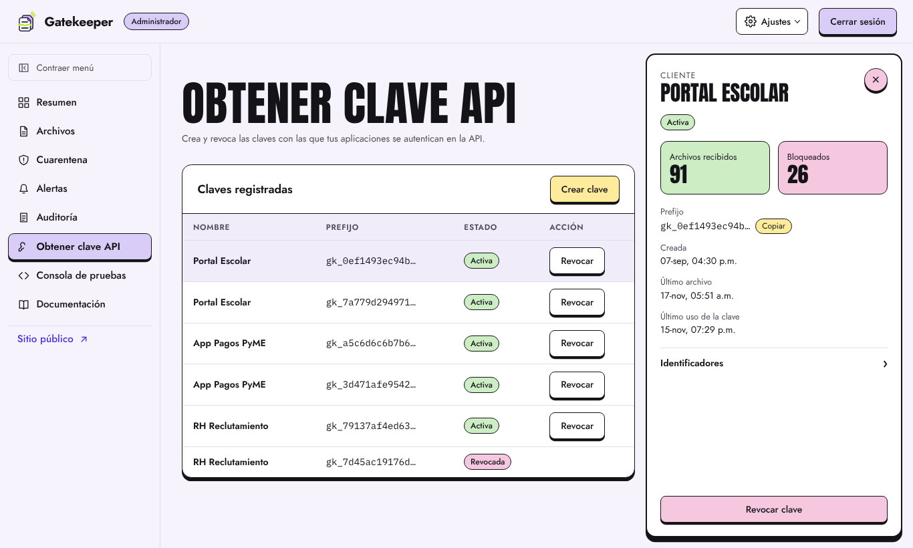
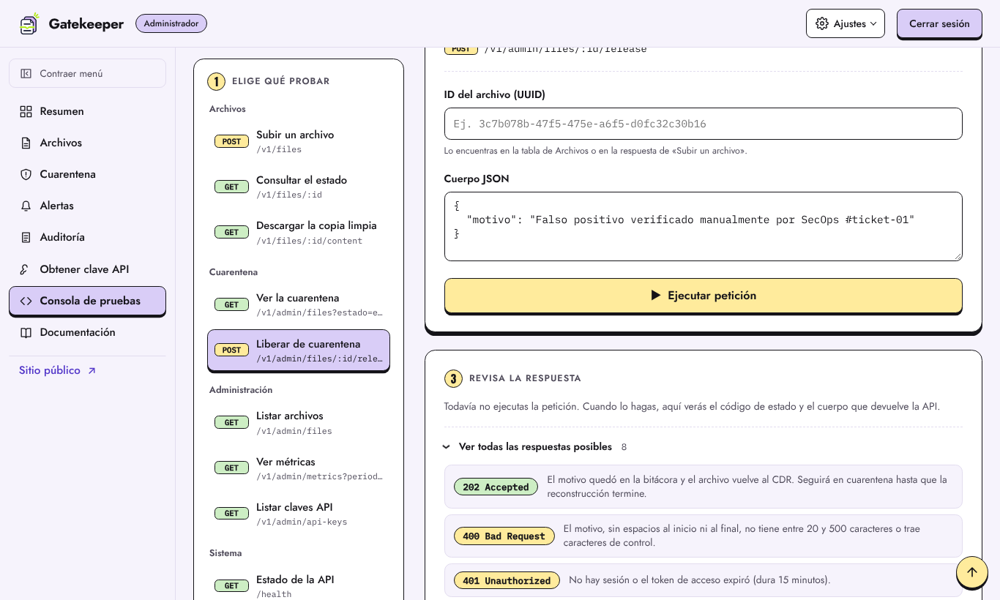
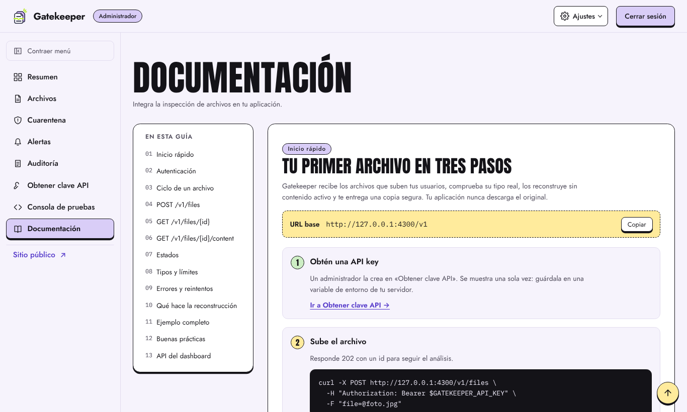

# Reporte Final del Proyecto: Gatekeeper · Frontend (Dashboard SecOps y Landing)

Este repositorio contiene la parte web de **Gatekeeper**: el **Dashboard SecOps** en Angular y la **landing pública** en Astro. La API, el motor CDR, el worker antimalware y la infraestructura viven en [GateKeeper-API](https://github.com/Rust7730/GateKeeper-API), cuyo README sigue esta misma estructura.

## Ficha de Identificación

- **Institución:** Universidad Politécnica de Chiapas
- **Carrera / Programa:** Ingeniería en Tecnologías de la Información e Innovación Digital
- **Asignatura:** Seguridad Informática
- **Profesor:** M.C. José Alonso Macías Montoya
- **Fecha de Entrega:** 22/11/2026
- **Nombre del Equipo / Grupo:** Grupo 7B
- **Nombre del Proyecto:** Gatekeeper — API intermediaria de validación, desarme y reconstrucción (CDR), análisis antimalware multicapa y consola SecOps

### Integrantes del Equipo

| Nombre Completo             | Matrícula | Correo Electrónico            | Rol / Enfoque Principal                       |
| --------------------------- | --------- | ----------------------------- | --------------------------------------------- |
| Luvia Magali Hidalgo García | 243732    | `243732@ids.upchiapas.edu.mx` | Frontend & UI/UX, Documentación y Pruebas     |
| Rodolfo Ramírez Reyes       | 423768    | `423768@ids.upchiapas.edu.mx` | Arquitectura, Backend API, Seguridad & DevOps |

## Sección I: Control de Acceso y Enlaces del Proyecto

| Recurso                                     | Enlace / Estado                                   | Notas de Acceso                                                                                            |
| ------------------------------------------- | ------------------------------------------------- | ---------------------------------------------------------------------------------------------------------- |
| **Repositorio de Código Fuente (Frontend)** | `https://github.com/Rust7730/GateKeeper-Frontend` | Público. Ramas: `main` (código), `dist-main` (build del dashboard) y `dist-landing` (build de la landing). |
| **Repositorio de Código Fuente (Backend)**  | `https://github.com/Rust7730/GateKeeper-API`      | Público (rama `main`).                                                                                     |
| **Aplicación Web / Dashboard SecOps + API** | `https://35-168-228-65.sslip.io/`                 | AWS EC2 con HTTPS (Let's Encrypt). Requiere usuario del equipo con TOTP.                                   |
| **Landing Page pública**                    | `https://34-231-193-98.sslip.io/`                 | AWS EC2 aislada con HTTPS. Español en `/` e inglés en `/en/`.                                              |
| **Video Demostrativo (3-5 min)**            | Pendiente                                         | Se agregará el enlace al publicarlo.                                                                       |

## Sección II: Declaración de Licencia de Software

### 2.1 Tipo de Licencia Seleccionada

- **Licencia Elegida:** Licencia MIT (_MIT License_). El archivo [`LICENSE`](LICENSE) está en la raíz del repositorio.

### 2.2 Justificación de la Licencia

Se eligió la **Licencia MIT** porque es permisiva y muy usada en software de seguridad: permite que la comunidad académica, auditores y desarrolladores inspeccionen, reutilicen, modifiquen y distribuyan el dashboard y la landing sin restricciones comerciales, conservando solo el aviso de derechos de autor y la exención de responsabilidad. Es la misma licencia del repositorio de la API, así el proyecto completo se distribuye con las mismas condiciones.

## Sección III: Resumen Ejecutivo y Planteamiento

### 3.1 Descripción del Proyecto

**Gatekeeper** es una plataforma de seguridad para la recepción de archivos en aplicaciones web. Una API intermediaria recibe los archivos que suben los usuarios, valida su tipo real por firma binaria, los analiza con ClamAV y VirusTotal (solo por hash) y los reconstruye con un motor **CDR** (_Content Disarm and Reconstruction_). La aplicación cliente nunca recibe el original, solo la copia reconstruida.

Este repositorio aporta las dos aplicaciones **web** del proyecto:

1. **Dashboard SecOps** (`src/`): SPA en **Angular 22** para analistas y administradores. Incluye inicio de sesión con contraseña y **TOTP (2FA)**, control de acceso por roles (`admin` y `analista`), resumen con gráfica de amenazas por día, listas de archivos y cuarentena con resumen lateral, liberación auditada de archivos, alertas en vivo por **SSE**, bitácora de auditoría, administración de **API keys**, una **consola de pruebas** de la API y la **documentación de integración** completa. Es bilingüe (español e inglés) con tema claro y oscuro.
2. **Landing pública** (`landing/`): sitio estático en **Astro 5**, en español e inglés, que explica el recorrido de un archivo por el pipeline con animaciones guiadas por el scroll, ejemplos de integración y la matriz de pruebas.

### 3.2 Planteamiento del Problema y Justificación

Recibir archivos de usuarios (facturas, identificaciones, comprobantes) es uno de los vectores de ataque más comunes en aplicaciones web: scripts disfrazados con doble extensión, archivos políglotas, PDF con JavaScript, bombas de descompresión y fugas de metadatos EXIF/GPS. Validar solo la extensión o el `Content-Type` se evade con facilidad.

Gatekeeper atiende el problema con defensa en profundidad en la API. Pero un pipeline de seguridad no basta si nadie puede **operarlo**: los equipos de seguridad necesitan ver qué se bloqueó y por qué, revisar la cuarentena, liberar falsos positivos con trazabilidad y controlar qué aplicaciones tienen acceso. El dashboard resuelve esa parte, y debe hacerlo sin convertirse en un nuevo punto débil: los nombres de archivo, hashes y metadatos que muestra vienen de usuarios potencialmente hostiles. La landing, por su parte, explica a los equipos de desarrollo cómo integrar la API correctamente.

### 3.3 Matriz de Cumplimiento de Objetivos

| Objetivo Inicial Planteado                                                                                                                                             | Estado de Implementación | Observaciones / Alcance Logrado                                                                                                                                                                                                                                      |
| ---------------------------------------------------------------------------------------------------------------------------------------------------------------------- | ------------------------ | -------------------------------------------------------------------------------------------------------------------------------------------------------------------------------------------------------------------------------------------------------------------- |
| **General:** Diseñar, implementar, auditar y desplegar una API intermediaria de validación, análisis antimalware y CDR de archivos, con un panel SecOps para operarla. | **Completado**           | Sistema en producción en AWS EC2 con HTTPS. Este repositorio entrega el dashboard y la landing desplegados por CI.                                                                                                                                                   |
| **Específico 1:** Diseñar la arquitectura y la API RESTful de ingesta, consulta, descarga y administración.                                                            | **Completado**           | API en FastAPI con 22 endpoints (detalle en [GateKeeper-API](https://github.com/Rust7730/GateKeeper-API)). El dashboard consume 13 de ellos mediante un adaptador tipado, y su consola de pruebas permite ejecutar otros 4 (los 3 públicos de archivos y `/health`). |
| **Específico 2:** Desarrollar el frontend web: dashboard SecOps con RBAC y 2FA, y landing pública.                                                                     | **Completado**           | Dashboard en Angular 22 con 8 secciones, SSE en vivo, resumen lateral en todas las tablas, consola de pruebas y documentación. Landing bilingüe en Astro 5 desplegada en una instancia separada.                                                                     |
| **Específico 3:** Pruebas de seguridad y calidad.                                                                                                                      | **Completado**           | 87 pruebas unitarias (Vitest), ESLint, Stylelint y un escáner propio de patrones prohibidos, revisados en cada commit y en CI. Pruebas del backend: matriz de 526 ataques, Bandit, OWASP ZAP y Trivy (ver el README de la API).                                      |

## Sección IV: Arquitectura Técnica y Stack Tecnológico

### 4.1 Stack Tecnológico

- **Frontend (Web):**
  - Dashboard: **Angular 22** (standalone, _zoneless_ con Signals), **TypeScript 6**, **Angular Material 22**, **RxJS**, **Apache ECharts 6** (gráficas en SVG), fuentes locales Anton y Jost (sin CDN).
  - Landing: **Astro 5**, generación estática en español e inglés.
  - Calidad: **Vitest 5**, **ESLint**, **Stylelint**, **Prettier**, **Husky** + **commitlint**.
- **Backend & API (repositorio aparte):** Python 3.12 con FastAPI, Uvicorn y ARQ.
- **Base de Datos:** PostgreSQL 16 y Redis 7 (los usa la API; el frontend nunca se conecta directo).
- **Infraestructura & Contenedores:** AWS EC2, Docker Compose, **Nginx** (sirve el dashboard y la landing con TLS de Let's Encrypt), **GitHub Actions** (publica los builds en las ramas `dist-main` y `dist-landing`) y actualización automática por _pull_ con timers de systemd.
- **Librerías y prácticas de seguridad en el frontend:** sanitización nativa de Angular (sin `innerHTML` ni `bypassSecurityTrust*`), token de acceso solo en memoria, _refresh token_ en cookie `HttpOnly` con cabecera CSRF, Content-Security-Policy con hash SHA-256 y validación estricta de cada respuesta de la API.

### 4.2 Diagrama de Arquitectura de la Solución



El dashboard se sirve desde el mismo dominio que la API, detrás de Nginx. La landing vive en otra instancia; los enlaces entre ambos sitios llevan el tema, el idioma y la preferencia de movimiento para que la experiencia sea continua.

### 4.3 Especificación de Endpoints Principales de la API

Endpoints que consume este frontend (la especificación completa de los 22 endpoints está en el README de la API y en la sección **Documentación** del dashboard):

| Método HTTP               | Ruta / Endpoint                                         | Descripción                                                                               | Requiere Autenticación        |
| ------------------------- | ------------------------------------------------------- | ----------------------------------------------------------------------------------------- | ----------------------------- |
| `POST`                    | `/v1/auth/login`                                        | Inicio de sesión con correo y contraseña (Argon2id); responde un desafío TOTP o la sesión | NO (con rate limit)           |
| `POST`                    | `/v1/auth/totp`                                         | Verifica el código TOTP y emite el token de acceso y la cookie de refresh                 | NO (requiere `desafio_id`)    |
| `POST`                    | `/v1/auth/refresh`                                      | Rota el refresh token; si detecta reuso, revoca toda la familia                           | SÍ (cookie `HttpOnly` + CSRF) |
| `POST`                    | `/v1/auth/logout`                                       | Cierra la sesión y limpia las cookies                                                     | SÍ (cookie + CSRF)            |
| `GET`                     | `/v1/admin/files`                                       | Lista paginada de archivos con filtros por estado y búsqueda                              | SÍ (JWT `admin`/`analista`)   |
| `GET`                     | `/v1/admin/files/{id}`                                  | Detalle del archivo; nombre, SHA-256 y capas solo si hay amenaza (K20)                    | SÍ (JWT `admin`/`analista`)   |
| `POST`                    | `/v1/admin/files/{id}/release`                          | Libera de cuarentena con motivo de 20 a 500 caracteres y re-CDR                           | SÍ (JWT `admin`)              |
| `GET`                     | `/v1/admin/metrics`                                     | Totales, amenazas por día, bloqueos por capa y aplicaciones                               | SÍ (JWT `admin`/`analista`)   |
| `GET`                     | `/v1/admin/audit`                                       | Bitácora inmutable de acciones                                                            | SÍ (JWT `admin`)              |
| `GET` · `POST` · `DELETE` | `/v1/admin/api-keys`                                    | Lista, crea y revoca API keys (el secreto se muestra una sola vez)                        | SÍ (JWT `admin`)              |
| `GET`                     | `/v1/admin/events`                                      | Alertas en vivo por Server-Sent Events                                                    | SÍ (JWT `admin`/`analista`)   |
| `POST` · `GET`            | `/v1/files`, `/v1/files/{id}`, `/v1/files/{id}/content` | Endpoints públicos que se prueban desde la consola del dashboard                          | SÍ (API key `Bearer`)         |

## Sección V: Matriz de Seguridad y Evidencias de Funcionamiento

### 5.1 Mecanismos de Seguridad Implementados

1. **Prevención de XSS y contenido hostil:** todo dato del backend se muestra por interpolación de Angular, que escapa el HTML. Un escáner propio (`scripts/check-security.mjs`) bloquea, en cada commit y en CI, el uso de `innerHTML`, `outerHTML`, `insertAdjacentHTML`, `document.write` y `bypassSecurityTrust*`. El entorno de desarrollo incluye un backend simulado con nombres de archivo hostiles (`<script>`, fórmulas de hoja de cálculo, caracteres de control RTL, rutas `../`) para comprobarlo.
2. **Validación estricta de respuestas (adaptador DTO):** cada respuesta se lee como `unknown` y se valida campo por campo: UUID, SHA-256, MIME, fechas y firmas de malware con expresiones estrictas. Un valor desconocido se convierte en `unknown` o `null`, nunca en el texto recibido. Las tablas de traducción usan `Map`, así que claves como `__proto__` o `constructor` no resuelven a nada.
3. **Divulgación mínima (K20) con falla cerrada:** si un archivo no está en cuarentena ni tiene malware detectado, el adaptador descarta nombre original, SHA-256, caducidad y resultados por capa aunque el backend los envíe. El tipo de TypeScript impide leerlos sin verificar primero.
4. **Gestión de sesión:** el token de acceso vive solo en memoria (nunca en `localStorage`; el escáner lo prohíbe). La renovación usa la cookie `HttpOnly` con una cabecera CSRF. Si una petición responde 401, el interceptor renueva la sesión (una sola renovación aunque fallen varias peticiones a la vez) y la reintenta; si la renovación falla, cierra la sesión.
5. **Control de acceso (RBAC):** `authGuard` protege todo el dashboard y `adminGuard` protege Auditoría y Claves API. El menú oculta las secciones de administrador a los analistas, y las acciones de liberar y revocar se deshabilitan para ellos. La API vuelve a verificar el rol en cada petición.
6. **Validación de entradas antes de enviarlas:** un `:id` que no es UUID nunca sale a la red (responde 404 local). En la consola, el campo de UUID se marca inválido y el botón se desactiva. Los motivos de liberación y los nombres de clave formados solo por espacios no pasan la validación.
7. **No exposición del original:** no existe ningún método para ver o descargar el archivo original; la consola solo ofrece la copia reconstruida (`/content`).
8. **Endurecimiento del despliegue:** Nginx sirve el dashboard con una Content-Security-Policy estricta (`script-src` con hash SHA-256, sin `unsafe-inline` en scripts y `font-src 'self'`), HSTS, `X-Content-Type-Options: nosniff` y `X-Frame-Options: DENY`. Las fuentes se empaquetan en el build y las herramientas de desarrollo quedan fuera del build de producción.
9. **Parámetros de URL con lista blanca:** la sincronización de preferencias entre la landing y el dashboard solo acepta valores conocidos (`tema`, `idioma`, `movimiento`); cualquier otro valor se ignora y se borra de la dirección.

### 5.2 Evidencias de Funcionamiento (Capturas de Pantalla)

#### Interfaz de Usuario (Frontend)

Capturas tomadas con el backend simulado del entorno de desarrollo (datos de demostración, incluidos nombres de archivo hostiles).

| Vista                                     | Captura                                                                                         |
| ----------------------------------------- | ----------------------------------------------------------------------------------------------- |
| Landing: portada                          |                                 |
| Landing: «Cómo funciona»                  |               |
| Dashboard: inicio de sesión               |                        |
| Dashboard: resumen y gráfica de amenazas  |                               |
| Dashboard: cuarentena con resumen lateral |           |
| Dashboard: claves API                     |               |
| Dashboard: consola de pruebas             |  |
| Dashboard: documentación de integración   |                  |

En la captura de cuarentena, los nombres `foto.jpg .php` y `<script>alert(1)</script>.jpg` aparecen como texto plano: el contenido hostil no se ejecuta.

#### Peticiones y Respuestas de la API

La **Consola de pruebas** del dashboard ejecuta peticiones reales contra la API y muestra el código de estado, la latencia y el cuerpo JSON. Para cada endpoint también lista todas las respuestas posibles. Ejemplo de la secuencia de ingesta:

```json
// POST /v1/files -> 202 Accepted
{ "id": "3c7b078b-47f5-475e-a6f5-d0fc32c30b16", "estado": "pendiente" }

// GET /v1/files/3c7b078b-47f5-475e-a6f5-d0fc32c30b16 -> 200 OK
{
  "id": "3c7b078b-47f5-475e-a6f5-d0fc32c30b16",
  "estado": "limpio",
  "tipo_detectado": "image/jpeg",
  "tamano_bytes": 48213,
  "sha256": "e3b0c44298fc1c149afbf4c8996fb92427ae41e4649b934ca495991b7852b855",
  "creado_en": "2026-11-21T18:12:04Z",
  "analizado_en": "2026-11-21T18:12:06Z"
}

// GET /v1/files/{id}/content con un archivo en cuarentena -> 409 Conflict
{ "detail": "Conflict" }
```

#### Pruebas de Seguridad / Análisis

En cada commit, Husky corre lint-staged, la revisión de índices y el escáner de seguridad. GitHub Actions corre la verificación completa (`npm run verify`) antes de publicar cada build:

```text
$ npm run verify
All files pass linting.                      # ESLint + Stylelint
✔ Índices de carpetas al día
✔ Sin patrones de seguridad prohibidos       # check-security: innerHTML, bypassSecurityTrust, tokens en storage…
 Test Files  10 passed (10)
      Tests  87 passed (87)                  # Vitest
Application bundle generation complete.      # build de producción
```

Las pruebas unitarias cubren el adaptador del backend (validación de cada DTO, K20, valores hostiles), el backend simulado con nombres hostiles, los interceptores, la consola, la agrupación de la gráfica por día local y la sincronización de preferencias. Las pruebas de seguridad del backend (matriz de 526 ataques, Bandit, OWASP ZAP y Trivy) están documentadas en el README de [GateKeeper-API](https://github.com/Rust7730/GateKeeper-API).

## Conclusiones y Trabajo Futuro

- **Conclusiones:** construir el panel de una herramienta de seguridad obligó a tratar al propio frontend como superficie de ataque. Los datos que muestra vienen de archivos subidos por desconocidos, así que validar cada respuesta, mostrar el mínimo necesario (K20) y prohibir por código los patrones peligrosos resultó tan importante como la API. También aprendimos el valor de las pruebas manuales de QA: encontraron errores que las pruebas automáticas no cubrían, como fechas desplazadas por la zona horaria, errores de ECharts al animar degradados y estados mal etiquetados. Todos se corrigieron y quedaron cubiertos por pruebas.
- **Trabajo Futuro / Mejoras:**
  1. Paginación completa en las tablas (hoy se muestran hasta 50 resultados por búsqueda).
  2. Pruebas _end-to-end_ automatizadas con Playwright contra la API real.
  3. Registrar en el backend el último uso de cada API key para mostrarlo en el resumen del cliente.
  4. Que el endpoint de métricas acepte la zona horaria del usuario, para no tener que agrupar la gráfica en el navegador.
  5. Webhooks firmados hacia las aplicaciones cliente, mostrados en el dashboard, para no depender del _polling_.

---

## Desarrollo local

### Requisitos

- **Node.js 22.22.3+, 24.15.0+ o 26+** (lo exige Angular CLI 22). Revisa con `node -v`.

### Dashboard

```bash
npm install          # instala dependencias y activa los hooks de git (husky)
npm start            # http://localhost:4200 con backend simulado
npm run verify       # lint + índices + seguridad + tests + build
```

Antes de trabajar, lee [`CLAUDE.md`](CLAUDE.md) y [`context/INDEX.md`](context/INDEX.md).

### Landing pública

```bash
npm ci --prefix landing
npm run landing:dev    # http://localhost:4321
npm run landing:build  # salida estática en landing/dist
```

En desarrollo, el enlace al dashboard abre `http://localhost:4200/login`. En producción, define `PUBLIC_DASHBOARD_URL` con la URL completa del dashboard antes de compilar la landing.
